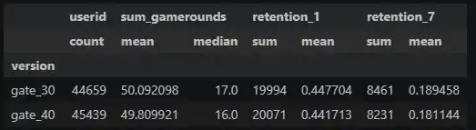
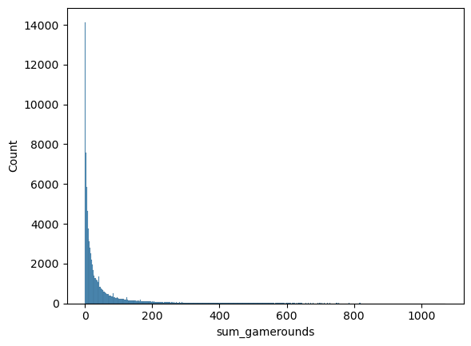
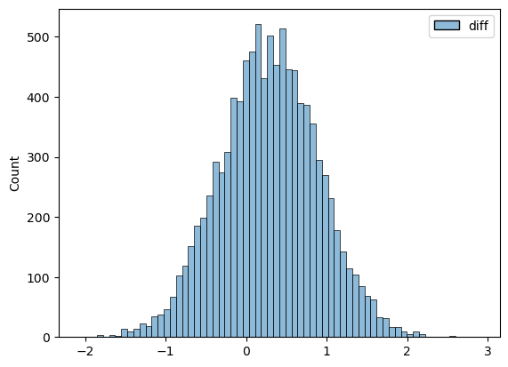

## Overview
This project analyzes the results of an A/B test for the mobile game *Cookie Cats*. The goal is to evaluate the impact of moving the first player gate (a forced pause in progression) from level 30 to level 40. 

## Questions to Answer
1. Does moving the gate to level 40 influence player retention (Day 1 and Day 7)?
2. Does the gate placement impact the total number of game rounds played by a user?

## Tools Used
- **Python**: Pandas, NumPy, SciPy, Seaborn

---

## 1. Exploratory Data Analysis (EDA)
- **Data Quality:** The dataset contains no missing values (NA) or duplicates.
- **Sample Size:** Users are evenly distributed between the control group ("gate_30": 44,700 users) and the test group (`gate_40`: 45,489 users).
- **Outliers:** The "sum_gamerounds" metric is highly right-skewed. Outliers were removed using the 99.9th percentile.
- **Observations:** The "gate_30" group shows a slightly higher average number of rounds played and higher retention rates for both Day 1 and Day 7.

---

## 2. Hypothesis Testing

**Null Hypothesis:** There is no statistically significant difference in engagement and retention metrics between the `gate_30` and `gate_40` groups.

### Retention Analysis (Chi-Square Test)
Since retention is a categorical/binary metric (Returned: Yes/No), the Chi-Square test of independence was applied.
- **Day 1 Retention:** $p\text{-value} = 0.07$. The difference is not statistically significant.
- **Day 7 Retention:** $p\text{-value} = 0.0014$. The difference is statistically significant, with "gate_30" outperforming "gate_40".

### Engagement Analysis (Bootstrap for Game Rounds)
Since the `sum_gamerounds` metric does not follow a normal distribution, a Bootstrap method (10,000 iterations with replacement) was used to construct a 95% Confidence Interval for the difference in means.

*Distribution before Bootstrap (Highly Skewed):*

*Distribution of Sample Means after Bootstrap:*

- **Result:** The 95% Confidence Interval for the difference in means includes 0. 
- **Conclusion:** The difference in the number of game rounds played between the two groups is not statistically significant.

---

## 3. Business Recommendation

1. Moving the gate to level 40 **does not** increase the number of game rounds played.
2. Moving the gate to level 40 **decreases** 7-day player retention. 

**Recommendation:** The product team should **keep the gate at level 30**. The earlier pause likely prevents players from burning out, leading to better long-term retention without sacrificing short-term engagement.